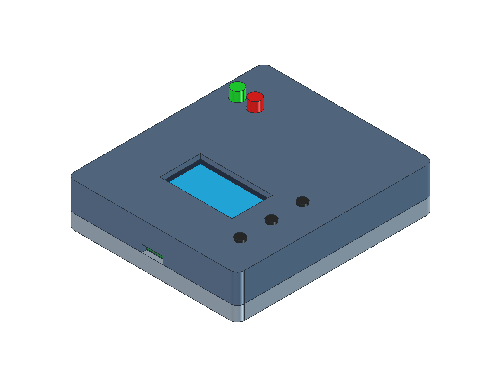
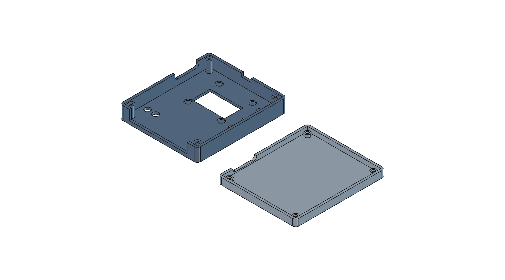
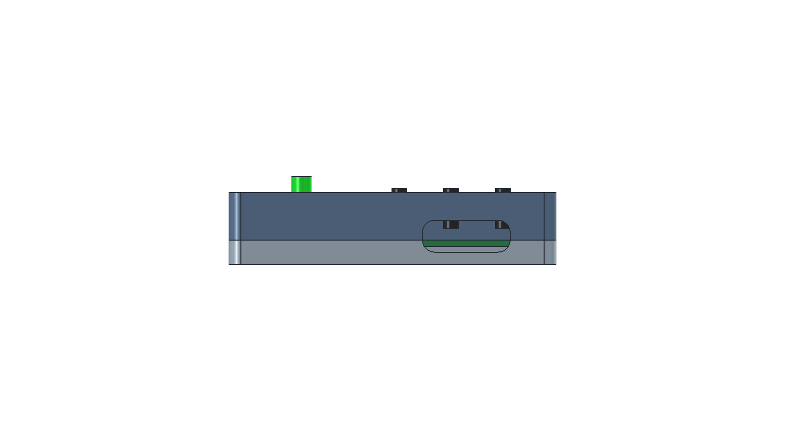

# Editable FreeCAD enclosure

Open **hp21xx_enclosure.FCStd** in FreeCAD. It contains the assembled upper shell and bottom cover, plus a simplified PCB/display/button/LED reference assembly. No extra workbench, macro or Python package is required to edit the saved model.







## Editing

1. Double-click **Dimensions — edit values in column B** in the model tree.
2. Change the dimension in column B and recompute the document. Units are millimetres. Yellow cells identify provisional dimensions.
3. Return to the 3D view to inspect the result.
4. Select **UPPER SHELL — finished part**, **BOTTOM COVER — finished part**, or **REFERENCE — PCB and simplified assembled parts** and press Space to toggle its visibility. Hide the upper shell to inspect PCB alignment and the short posts. Hide the cover and reference assembly, then rotate the view, to inspect the long upper posts.

The model uses native Part primitives and boolean operations with expressions linked to the dimensions sheet. Expand the finished parts in the tree to inspect their construction. Spreadsheet-controlled properties should be edited through the sheet. The model contains no custom Python feature requiring the builder at load time.

Useful parameters:

| Parameter | Purpose |
| --- | --- |
| PanelTop | Front outer face height above the PCB top; currently 12 |
| BoardWidth / BoardLength | Measured PCB envelope, currently 66.6 × 77.5 |
| BoardGap | Clearance per edge, currently 0.3; cavity is 67.2 × 78.1 |
| LayoutWidth / LayoutLength | Original KiCad datum, 66.5 × 77.4; keep fixed to preserve hole coordinates |
| UnderBoard | Short-post length and clearance below PCB underside; currently 2.5, specified by user |
| Wall / PanelThickness / CoverThickness | Shell and cover thicknesses |
| PostDiameter | Diameter of both sets of corner posts |
| PilotDiameter / PilotDepth | Blind self-tapping screw pilot in the long upper posts |
| ScrewClearance / HeadDiameter | Rear clearance bores and 90-degree countersinks |
| DisplayMargin | Extra aperture space on every edge of the illuminated area |
| DisplayScrewReliefDiameter / DisplayScrewReliefDepth | Blind recesses inside the front panel above the display screws |
| UsbWidth / UsbTop | USB plug access slot size |
| SdWidth / SdTop | Supplied SD envelope; actual opening is enlarged by the finger recess |
| SdFingerWidth / SdFingerHeight | Shared finger opening size; currently 22 × 8 |
| SdFingerCenterZ / SdFingerRadius | Opening centre above PCB and corner radius; currently 1 and 3 |
| RibbonWidth / RibbonTop | Header, plug and latch access slot size |
| LedHole / ButtonHole | User-specified front opening diameters: 5.3 / 3.4 |

Keep `CornerRadius > Wall`, positive wall/post dimensions, and `PilotDepth < PanelTop - PanelThickness`. Keep `DisplayScrewReliefDepth < PanelThickness`. Keep `2 × SdFingerRadius` smaller than both finger-recess dimensions and the recess bottom above the bottom-cover inner floor to preserve the floor thickness. When changing the screw dimensions, the physical PCB mounting holes remain 2.5 diameter. Keep sufficient plastic beneath the countersunk heads and check that each post still clears nearby components. Large design changes may require editing the native construction as well as the dimensions sheet.

## Construction and dimensions

The draft envelope is **71.2 × 82.1 × 18.1 mm**, excluding protruding LEDs, buttons and connectors. The PCB top is Z = 0. X points toward the buttons, Y toward the ribbon connector and Z out through the front panel.

The four long upper posts contact the PCB top. Four short bottom-cover posts contact the PCB underside. Screws enter through the bottom cover countersinks, pass through the short posts and existing PCB mounting holes, then thread into the upper posts. The cover screws also clamp the PCB; there are no separate PCB fasteners.

Current heights: front panel outer face Z = 12, inner face Z = 10, upper post length 10, PCB underside Z = -1.6, short post length 2.5, cover inner face Z = -4.1, cover outside Z = -6.1. The bottom cover is now a tray: its perimeter walls rise to PCB top level, Z = 0, and meet the upper shell there. Seat the PCB on the lower posts in the tray, then fit the upper shell. Connector slots in the upper shell open at this joint.

The manufactured PCB measures 66.6 × 77.5. The cavity is 67.2 × 78.1, giving 0.3 clearance per side. The inside corner radius tracks BoardGap (currently 0.3) to preserve clearance around square PCB corners.

The measured outline is assumed centred on the original 66.5 × 77.4 KiCad outline, extending 0.05 beyond it on each edge. Mounting holes, button centres, LED centres and connector locations retain the original KiCad coordinates; they are not rescaled or moved with the measured board envelope. Physical mounting-hole offsets have not been remeasured. The display aperture follows the measured 28.5 × 15.3 illuminated area and confirmed 4 offset below the upper mounting-hole centres. It has 0.8 clearance per edge. The display is assumed horizontally centred between its mounting-hole columns.

The reference assembly is simplified: connector bodies, mating cables, card, solder joints, screws and actual OLED internal layers are not modelled. LED cylinders show the measured tip height, rather than the inaccurate stock KiCad model placement. The button reference cylinders retain an unmeasured 4 mm diameter assumption; they do not define the user-specified 3.4 mm openings. The full KiCad STEP reference remains in `../../build/enclosure/pcb-reference.step`.

The front panel has three **3.4 mm diameter button openings** and two **5.3 mm diameter LED openings**, as specified by the user. The model before reducing these from 4.8 and 6.2 mm respectively is preserved in `revisions/before_front_hole_reduction.FCStd`.

## SD-card finger access

The card protrudes only 1 beyond the PCB edge. A shared rounded cut through both halves replaces the tight SD slot with a **22 wide × 8 high opening, corner radius 3**, centred at Z = 1. It extends from Z = -3 to Z = 5 and removes the full 2 wall thickness locally. The rest of the walls remain 2 thick; the bottom floor stays intact, with 1.1 of lower wall remaining between the recess bottom and the tray inner floor.

The recess gives a fingernail access to the card edge without the lower-tray wall obstructing the approach. No PCB revision is needed for this geometry change. Actual push-to-release travel and comfort still need a physical fit check. The opening is controlled by the four `SdFinger...` dimensions; both halves share the same cutter, so they remain aligned when edited.

The preceding model without the finger recess is preserved in `revisions/before_sd_finger_recess.FCStd`.

A planned PCB redesign will replace microSD with a full-size pull-out SD card. The requested future card opening is 1 mm high; its width and position will follow the revised PCB. The current model retains the existing microSD finger recess pending that redesign.

The model before reducing the board clearance is preserved in `revisions/before_reduced_board_clearance.FCStd`.

## Fit checks before fabrication

The underside clearance is 2.5 as specified by the user. Nominal connector envelopes are **USB-C 9 × 3**, **microSD 13.5 × 2**, and **ribbon 53 × 9**, each measured from PCB top. USB-C and ribbon openings retain those nominal dimensions. The SD opening is now enlarged by a shared rounded finger recess described below. The dimensions sheet remains editable if a fit check shows a need for additional clearance. Physical fit, mating plug/latch access, LED flange clearance, display screw-head recesses and screw dimensions still need verification. Neither printing method nor material has been specified.

The pilot is initially 1.7 diameter, clearance bores 2.5 and countersink head diameter 4.4, as a starting point for a small self-tapping countersunk screw of roughly 2.2 nominal diameter. Select an actual screw and adjust these values for its geometry and the enclosure material. Check length against the complete stack and blind-pilot depth; no specific purchased screw has been validated.

The initial model with the flat bottom cover is preserved in `revisions/initial_flat_bottom_cover.FCStd`.

## Files and validation

- `hp21xx_enclosure.FCStd`: editable native model with saved view and colours.
- `hp21xx_enclosure.step`: portable export of the two enclosure solids.
- `upper_shell.stl`, `bottom_cover.stl`: draft mesh exports in assembly coordinates; orient them as appropriate in a slicer.
- `assembled.png`, `inside.png`, `underside.png`, `sd_access.png`: review images.
- `validation.json`: actual build version, dimensions and geometry checks.
- `build_enclosure.py`: reproducible builder using the installed FreeCAD Python environment. Running it regenerates the files and overwrites model edits; save a separate copy before rebuilding.

Validation checks both halves are single valid solids, confirms no volume overlap between shell/cover/PCB, checks that the joint lies at PCB top and port sizes match the supplied dimensions, checks the four paired clamping contacts and coaxial screw bores, changes the panel height to verify spreadsheet propagation, verifies that the finger recess clears both halves, leaves the floor intact and provides an unobstructed nail approach, changes the finger width to check both halves update, and reopens/recomputes the saved FCStd.

To regenerate on this Mac:

```sh
/Applications/FreeCAD.app/Contents/Resources/bin/python box/cad/build_enclosure.py
```
